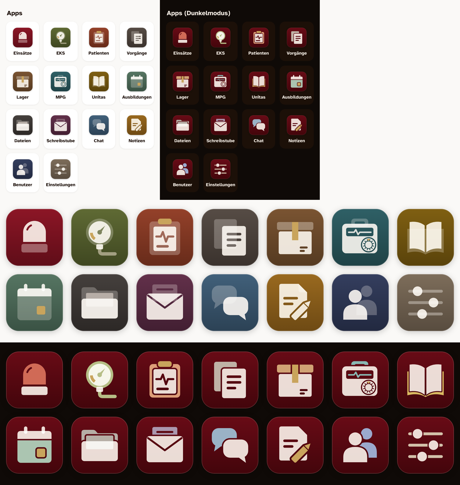

# Hub-Icons „Farbkacheln“

Stand 14.11.2026. Vom Owner abgenommen und am 14.11.2026 in den Hub eingebaut
(`npm run hub-icons`, siehe unten). Dieser Ordner bleibt die Quelle.



- **Hell:** jede App eine eigene gedeckte LBF-Kachelfarbe, Motiv aus hellen,
  durchscheinenden Flächen, höchstens ein kleines Messing-Detail.
- **Dunkel:** alle Kacheln Bordeaux; der Akzent nimmt die helle App-Farbe auf.

| App | Farbe (hell) |
|---|---|
| Einsätze | rosso |
| EKS | oliva |
| Patienten | terracotta |
| Vorgänge | ardesia |
| Lager | tabacco |
| MPG | petrolio |
| Unitas | senape |
| Ausbildungen | salvia |
| Dateien | grafite |
| Schreibstube | prugna |
| Chat | schiefer |
| Notizen | ocra |
| Benutzer | inchiostro |
| Einstellungen | cappuccino |

## Dateien

- `bau.mjs` erzeugt `icons.json` (hell) und `icons-dunkel.json` (dunkel):
  je App das SVG-Innenleben für `viewBox="0 0 100 100"` samt Hintergrund.
- `vorschau.mjs` zeigt sie im Hub (hell und dunkel) und schreibt `vorschau.png`.

```bash
node docs/entwuerfe/hub-icons/bau.mjs
node docs/entwuerfe/hub-icons/vorschau.mjs
```

## In der App

- `npm run hub-icons` (`scripts/hub-icons-bauen.mjs`) führt `bau.mjs` aus und schreibt
  `src/lib/hubIcons.ts`: je App ein rundes SVG für hell und dunkel als `data:`-Adresse, IDs je
  Symbol eindeutig. Die Datei nicht von Hand ändern. Fehlt zu einer App aus `ALL_APPS` ein
  Symbol, bricht das Skript ab.
- Angezeigt über `src/components/HubIcon.tsx` (Hub, Apps anpassen, Neuigkeiten, Einführung).
  Welche Fassung zu sehen ist, regelt `.hub-icon` in `src/styles/globals.css`: hell, dunkel,
  System; Retro zeigt die hellen Kacheln.
- Prüffälle: `src/lib/__tests__/hubIcons.test.ts`.

## Offen

- MPG: Die Prüfplakette kann in Hub-Größe noch wie ein Drehknopf wirken.
- Senf (Unitas) und Ocker (Notizen) liegen nah beieinander.
- Einsätze und Patienten sind auch im Hellmodus rot. Ob das so bleibt, ist offen.

Eigene Zeichnungen. Nichts von Apple übernommen, kein Rotes Kreuz und kein anderes Schutzzeichen.
